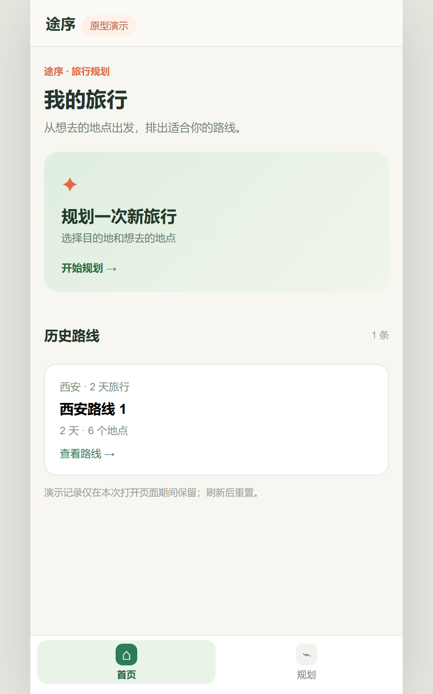
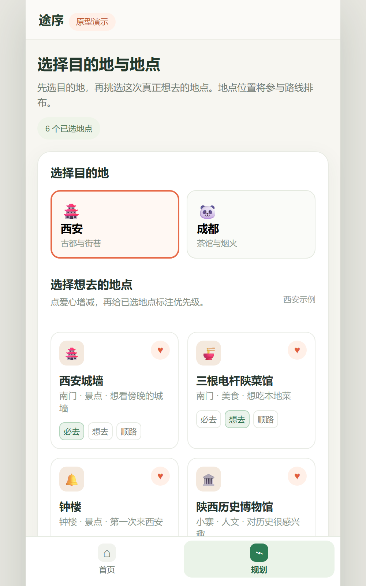
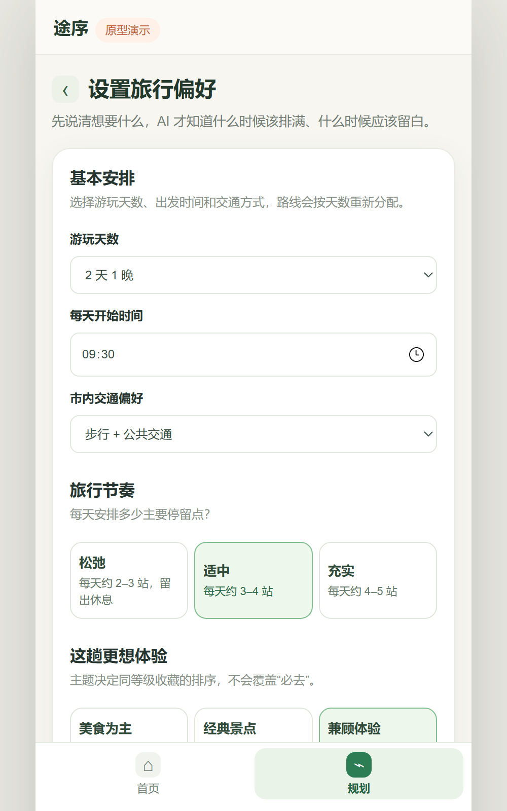
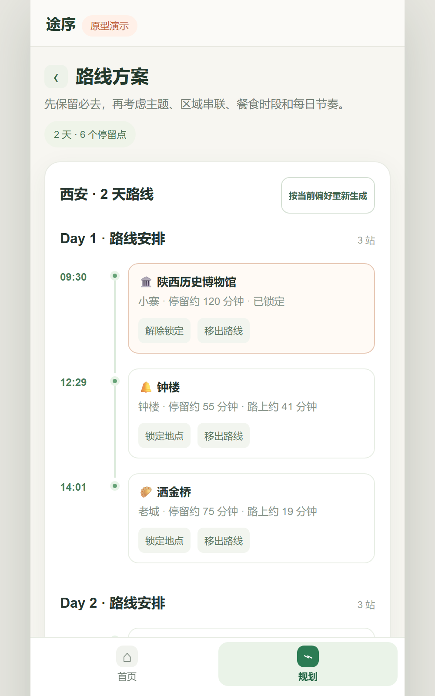
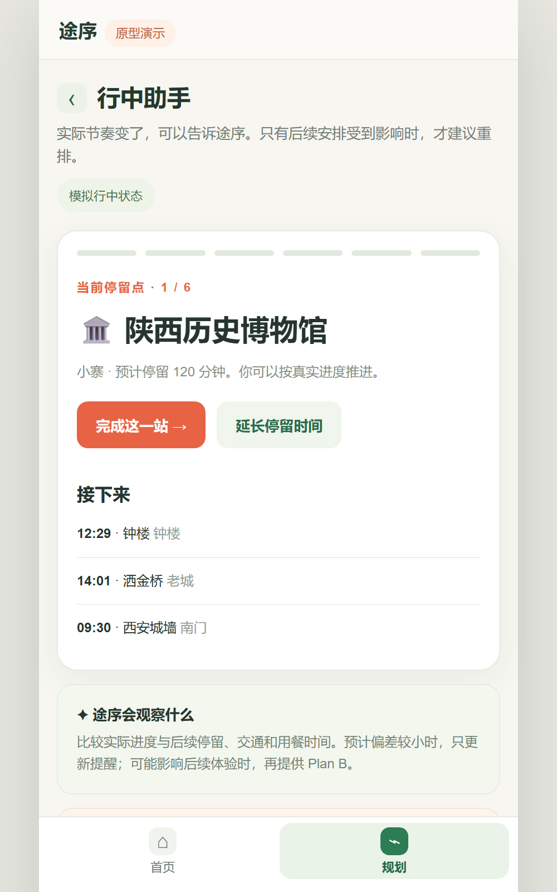
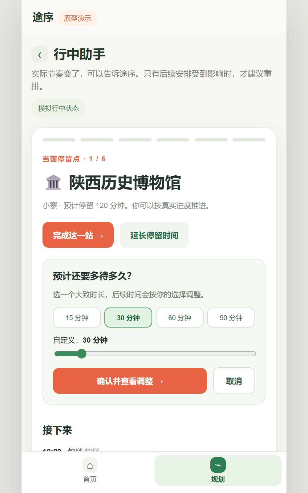
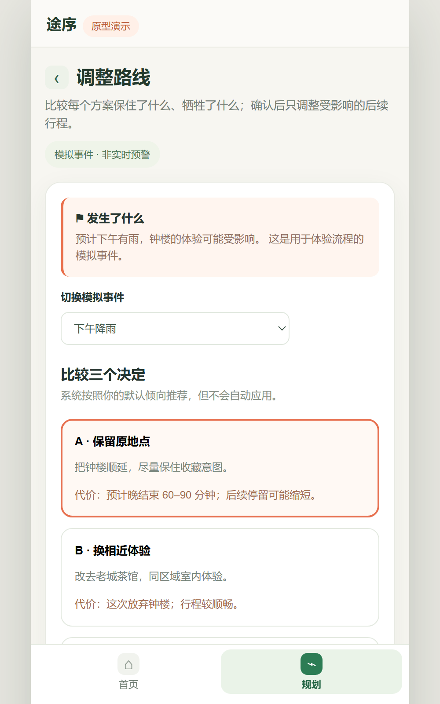

# 产品原型作品集

这里展示三个独立原型：面向年轻人社交媒体使用反思的「心境 MindMirror」、帮助用户研究者整理访谈材料的「访研搭档」，以及旅行线路与动态 Plan B 工具「途序 Tripwise」。

## 在线体验

[打开三个项目的独立入口](https://YYYYskbfxx.github.io/AI-Demo/)

[心境 MindMirror](docs/mindmirror-project.html) · [访研搭档 Research Copilot](docs/research.html) · [途序 Tripwise](docs/travel.html)

GitHub Pages 展示三个项目入口。心境的公开页面包含项目介绍和早期离线交互稿；实时 DeepSeek 对话与历史记录需要运行 [`mindmirror/`](mindmirror/) 中的 Node 服务。访研搭档可在另行配置 Node 服务后调用模型；途序当前为规则驱动的交互原型。

## 1. 心境 MindMirror

[查看心境项目介绍](docs/mindmirror-project.html) · [查看 Agent 源码与运行说明](mindmirror/) · [体验早期离线交互稿](docs/mindmirror.html)

### 项目背景

社交媒体已经成为年轻人社交、表达和获取信息的重要渠道，过度使用也会影响日常生活。单纯限制屏幕时间难以回应用户刷手机背后的情绪和想法。MindMirror 关注年轻人与社交媒体使用之间的关系，尝试用结构化自我反思帮助用户理解反复刷手机的情境。

### 项目内容

心境是基于 CBT 的八天对话式 Agent。第 1 天轻松介绍与确定个人目标，第 2—7 天围绕具体使用情境反思，第 8 天回顾。服务端通过火山方舟调用 DeepSeek，由情境理解、CBT 策略、回复整合三个角色协作，从 `knowledge.json` 选择证据探测、可能性放大镜或视角转换。支持多轮对话、结束或继续当天对话、按日期保存旅程及查看历史。源码位于 [`mindmirror/`](mindmirror/)；API Key 与对话记录不包含在仓库中。

### 界面设计

新版 Web 界面以旅程、日期导航和聊天区组织八天流程。发送后消息立即显示在对话区，模型回复期间展示生成状态；历史页按旅程和日期查看记录。移动端采用响应式布局。GitHub Pages 上的旧页面仅展示早期离线交互稿。

## 2. 访研搭档 Research Copilot

### 项目背景

研究者需要把研究目标、主观反馈和客观记录连起来，并在提出产品机会前核对证据。访研搭档是一个通用的用户研究工作台；手机端 AI 助手新功能试用只是内置的模拟案例。

### 项目内容

独立页面：[访研搭档工作台](docs/research.html)。支持编辑研究内容、目的、范围样本与评价维度，生成可修改的研究方案；按主观或客观资料导入 CSV、TXT 或粘贴文本，预览字段映射、参与者 ID 和缺失情况；分析工作区展示可编辑洞察、支持与相反证据、原始记录定位、人工确认状态，以及从已确认洞察出发的产品机会卡。报告只汇入研究者确认和保留的内容。当前工作区保存在浏览器本地存储中。

内置模拟案例包含 6 位虚构参与者、每日资讯推荐与每日总结两项虚构功能试用、访谈摘录、任务观察和试用后评分，共 24 条记录。样本覆盖不均，适合演示证据核对与分析流程，不用于推断真实产品表现。离线模式的候选洞察和对话引导由预置资料与规则驱动；配置 Node 服务和模型后，工作区右侧可围绕选中洞察及其引用记录进行模型多轮对话。聊天建议需研究者预览后才会写入卡片。

### 界面设计

页面按「研究设计 → 资料导入 → 分析工作区 → 结论与报告」组织。分析工作区为「可收起的材料栏 + 可编辑洞察与机会卡 + 可收起的研究对话」。点击证据编号会展开材料栏并定位原始记录。三个项目各有独立页面，作品首页只负责进入项目。

## 3. 途序 Tripwise｜旅行规划与动态调整

[体验移动端原型](docs/travel.html)

### 项目介绍

旅行前，用户常在不同平台收藏景点和餐厅，却仍要自己判断哪些地方值得优先去、怎样串成顺路的日程；旅行中，停留时间、天气、人流或交通一旦变化，又需要重新取舍。途序尝试把这两次决策放进同一条流程：**从用户真正想去的地点出发，生成可调整的路线，并在变化发生时让用户看清每种 Plan B 的代价。**

### 核心体验

1. **选地点，表达想去的程度。** 选择目的地和收藏地点，标注“必去 / 想去 / 顺路”，避免把所有收藏当成同等重要。
2. **按偏好排路线。** 设置游玩天数、每日节奏、旅行主题和交通方式。原型综合地点优先级与示意位置分配每日停留点，并展示排程理由；用户可锁定或移出地点。
3. **行中共同调整。** 用户可记录当前地点预计延长的停留时间。出现模拟的天气、人流或交通变化时，对比“保留顺延 / 相近替换 / 减少一站”，确认后再应用调整。
4. **回看历史路线。** 首页保存本次页面会话生成的路线，方便返回查看。

### 页面设计与功能

底部保留「首页 / 规划」两个入口。规划依次完成地点选择、偏好设置和路线生成；从路线进入行中助手与 Plan B。以下为同尺寸手机视口截图，点击可查看完整页面。

#### ① 开始规划

<p align="center">
<a href="docs/images/tripwise/home.png"></a>&nbsp;&nbsp;
<a href="docs/images/tripwise/places.png"></a>
</p>

- **首页：**发起新规划，或打开本次会话保存的历史路线。
- **选择地点：**选择城市与收藏地点，标记「必去 / 想去 / 顺路」；地点位置与优先级参与排程。

#### ② 生成路线

<p align="center">
<a href="docs/images/tripwise/preferences.png"></a>&nbsp;&nbsp;
<a href="docs/images/tripwise/route.png"></a>
</p>

- **规划偏好：**设置游玩天数、开始时间、交通方式、节奏、主题和变化时的默认倾向。
- **路线方案：**按天查看预计到达时间、停留和路程；可锁定、移出地点或重新生成。

#### ③ 旅行中调整

<p align="center">
<a href="docs/images/tripwise/journey.png"></a>&nbsp;&nbsp;
<a href="docs/images/tripwise/delay.png"></a>
</p>

- **行中助手：**记录当前站是否完成，查看后续安排。
- **延长停留：**快捷选择 15、30、60、90 分钟，或在 10–180 分钟内自定义时长。

#### ④ 比较 Plan B

<p align="center"><a href="docs/images/tripwise/planb.png"></a></p>

<p align="center">模拟天气、人流或交通变化，比较保留、替换与减少一站的取舍；用户确认后才应用。</p>

截图中的地图、地点位置、时间与事件均为演示数据；历史路线刷新后重置。

### 原型边界

这是用于展示产品流程的**本地规则驱动 demo**，尚未接入实时地图、天气、人流、交通或大模型接口。地点位置、路程、事件与时间均为演示数据或估算，路线未经过真实出行验证；历史路线在刷新页面后重置。

## 本地运行

需要 Node.js 18 或更高版本，无第三方运行依赖：

```bash
npm run dev
```

打开 `http://localhost:5196`。未配置模型接口时，系统使用离线演示回复。

## 接入 OpenAI 兼容接口

复制 `.env.example` 为 `.env`，填写服务商支持的模型和凭证：

```dotenv
OPENAI_API_KEY=your_key
OPENAI_BASE_URL=https://api.openai.com/v1
OPENAI_MODEL=gpt-4o-mini
PORT=5196
```

然后运行 `npm run dev`。服务端通过 `/api/mindmirror`、`/api/research` 和新版工作台的 `/api/research-chat` 调用 `/chat/completions`，API Key 只在服务端读取。不要将真实 `.env` 提交到仓库；使用前请确认模型服务商的数据处理政策。独立的模拟资料 CSV 位于 `docs/sample-research/`。

## 部署在线 AI 体验

GitHub Pages 只能托管静态文件，不能运行 Node 服务或安全保存模型 Key。最简单的在线部署方式是把本仓库作为一个 Render Web Service 部署；Render 会同时托管网页和 `/api` 接口，因此不需要额外配置跨域。

1. 在 Render 选择 **New → Web Service**，连接 `YYYYskbfxx/AI-Demo` 仓库和 `main` 分支。
2. Runtime 选择 **Node**，Build Command 填 `npm install`，Start Command 填 `npm start`。
3. 在服务的 **Environment** 中添加 `HOST=0.0.0.0`，以及模型服务所需的 `OPENAI_API_KEY`、`OPENAI_BASE_URL`、`OPENAI_MODEL`。`PORT` 由 Render 自动提供，无需手动设置。
4. 点击 **Deploy**。部署完成后打开 Render 提供的 `onrender.com` 地址，即可体验实时 AI 版本；GitHub Pages 地址仍然是离线体验版。

模型参数示例：

```text
OPENAI_API_KEY=在模型服务商创建的密钥
OPENAI_BASE_URL=https://api.openai.com/v1
OPENAI_MODEL=gpt-4o-mini
HOST=0.0.0.0
```

请将密钥直接填入 Render 的环境变量页面，不要写进网页代码、GitHub 仓库或聊天消息。使用其他 OpenAI 兼容服务商时，按其文档填写 Base URL、模型名和密钥。

在线接口会消耗模型账户额度。公开演示前请在模型服务商后台设置用量上限，并避免在演示中输入真实访谈、医疗或其他敏感信息。

## 技术实现

- 原生 HTML、CSS、JavaScript 前端，适配窄屏。
- Node.js 内置 HTTP 服务，无生产依赖。
- 可选 OpenAI 兼容接口；GitHub Pages 默认展示离线交互。
- Render 部署时由同一个 Node 服务托管网页与模型代理接口。
- 早期离线心境页面不持久化练习内容；新版 [`mindmirror/`](mindmirror/) 服务在本机 `data/` 保存对话与日期记录，该目录不上传 GitHub。访研搭档的工作区保存在本机浏览器中；途序历史路线仅在当前页面会话保留。接入实时模型后，相关输入会发送至所配置的模型接口。

```text
ai-builder-demos/
├── docs/
│   ├── index.html       # 三个独立项目的入口
│   ├── mindmirror-project.html  # 心境项目介绍
│   ├── mindmirror.html  # 心境早期离线交互稿
│   ├── research.html    # 访研搭档
│   └── travel.html      # 途序
├── mindmirror/          # 新版心境 Agent 源码与运行说明
├── server.mjs           # 旧离线原型的静态服务和可选模型代理
└── README.md
```

## License

MIT
